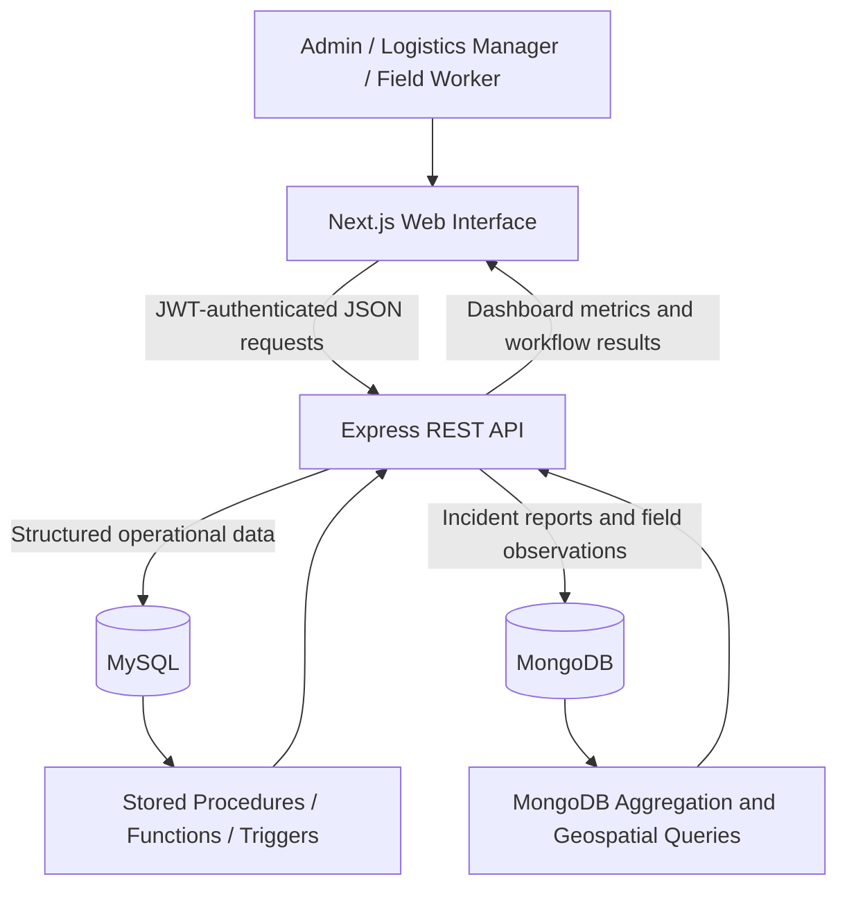

# System Architecture

## Responsibilities

- **Next.js frontend:** sign-in experience, role-aware navigation, dashboards, forms, filters, tables, and workflow actions.
- **Express API:** authentication, authorization, validation, business rules, and coordination between the two databases.
- **MySQL:** structured records with relationships and constraints, including victims, requests, depots, shelters, supplies, vehicles, routes, and delivery assignments.
- **MongoDB:** incident reports and field updates, including document validation, aggregation, and geospatial lookup.

## Important data flows

1. The user signs in through the Express authentication endpoint and receives a JWT.
2. The browser sends the JWT in the Authorization header for protected API calls.
3. The API checks the user's role before executing protected operations.
4. Dashboard endpoints aggregate MySQL operational data and return ready-to-display metrics.
5. Incident and field-update screens read/write MongoDB through Express.
6. Request matching and delivery completion invoke database procedures and preserve the backend's transaction/locking rules.

The browser never connects directly to either database. Database credentials remain in the backend environment configuration.
